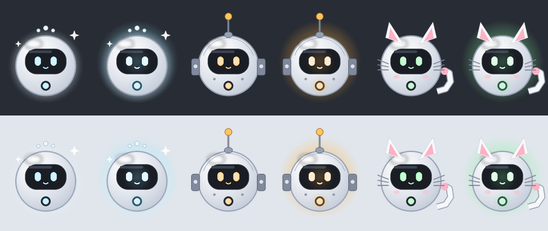

# Bot Beacons

Little floating companions on your Windows desktop, one for each of your Grok Bots.

## What it is

Bot Beacons are small floating avatars on your Windows desktop, one for each of your Grok Bots. They sit quietly and play a small idle animation. When a bot has something for you, its beacon glows and shows a one-line summary. **Open in chat** takes you straight to that chat. Click a beacon to open its conversation and reply right there, or right-click → **Ping** to call its bot. You don't need the Grok Bot app open.

## Why install it?

Your bots work in the background, but you only find out what they've done if you keep checking the app. Bot Beacons puts them on your desktop as small avatars that stay out of your way. You can see at a glance when one needs you, and call on any of them with one click.

- **Know when a bot needs you, without checking.** A beacon glows when its bot has finished something, found something, or needs you to approve or sign in. Glance over, read the one-line summary, and open the chat only if it matters.
- **Call a bot in two clicks.** Right-click a beacon → **Ping** to call its bot. By default the bot asks how it can help, but you can give each bot its own ping action. A news bot could send the top headlines, a research bot a status rundown, a briefing bot today's summary.
- **Quick replies without the app.** Answer straight from the bubble for small back-and-forths.
- **Stays out of your way.** It never interrupts your typing. Alerts just glow, and the important ones stay until you deal with them. Don't want to see a beacon today? Hide it. Its messages wait for you, and the tray icon still tells you when something arrives.
- **Your bots, your style.** Every beacon can look however you like. A pile of chat tabs becomes a row of little desk companions.

Put simply, it gives you a calm glance at what your bots are up to and one click to summon any of them.

## Getting it

Give your Grok Bot the link to this project and say **"set this up for me"**. Your bot reads [docs/SETUP.md](docs/SETUP.md) and does the rest:

- It makes a beacon for each of your bots and installs the app on your PC.
- It links the app securely to your bots and sets it to start with Windows.
- It sets up a reply router, so your replies and pings reach the right bot within seconds.
- If you want, it makes a folder in your home directory for finished work like PDFs.

All you do is approve a few cards, paste one pairing code into chat, and copy one webhook URL and key from the Grok Bot app into the beacon's **Wake hook…** window.

### Download (ready-to-run)

Prefer not to build it? Each [release](https://github.com/SnazzyGaz/bot-beacons/releases/latest) has a ready-to-run `BotBeacons-<version>-win.zip` with a prebuilt `BotBeacons.exe`. Check its SHA-256 against the one in the release notes, unzip it anywhere, and in that folder run:

`powershell -NoProfile -ExecutionPolicy Bypass -File install.ps1`

It installs for your user only, with no admin rights, and starts the app, which shows a one-time pairing code. Then give your Grok Bot the link to this project so it can finish the setup from [docs/SETUP.md](docs/SETUP.md). The exe isn't code-signed, so Windows SmartScreen may show "Windows protected your PC" the first time it runs: choose **More info**, then **Run anyway**. If you'd rather build it yourself, the source and `build.bat` are right here, and your bot can build it on your PC for you.

## Themes

You start with three ready-made characters: a cat, a robot and a glowing white orb. They share one body with different accessories, idle animations and colours. Your bot can design fully custom ones for you, each with its own look, idle animation and alert. See [docs/THEMES.md](docs/THEMES.md).

Right-click a beacon (or the tray icon) for one short menu: **Reply to** each bot, **Mark all read**, then **Skin** (all floating or all tabs, bubble style: dark card or cloud, and Animations: Full, Subtle or Off plus the frame rate), **Layout** (tab size, open tabs on click or hover, throw to dock), **Sounds**, **Bots** (show or hide, pause, test beacons, pairing), **Updates**, **Start with Windows**, **About** and **Exit**. Motion is drawn at 60 fps with sub-pixel smoothing by default.

### Floating beacons and tabs

Each beacon can float on your desktop (the default) or be a **tab**: a small bookmark docked to the edge of your screen. Click anywhere on a floating beacon to open its conversation; drag it to move it. Drag a floating beacon to the outer edge of a monitor and it docks as a tab there, or **throw** it at an outer edge and it docks where it hits (right-click → Layout → **Throw to dock** turns this off). Between two monitors, hold the beacon still at the shared edge for half a second and a dock preview appears: let go to dock it there, or keep moving to cross to the other screen. Drag a tab well into the screen and it floats again. Floating beacons and tabs can be on screen together; right-click → **Skin** has **All floating** and **All tabs**. Click a tab and its card slides out with the bot's picture, role, time and full latest message (links clickable). Click the card to reply right there, with **Open in chat** and **Dismiss** beside it. Esc, a click elsewhere or another click on the tab slides it back. **Open tabs on** (Click / Hover) and **Tab size** (Small / Normal / Large) are under Layout. Click the grip at the end of a strip, or Layout → **Open the whole shelf**, for the whole shelf. Alerts pop the tab out with a red "!" and play its sound. Each tab shows the beacon's own picture in a disc of its colour by default. The pencil lets you rename a tab, pick its picture (**Beacon picture**, the **Bot's profile picture** once the bot has sent one with `beaconctl.py avatar`, or a **Custom image**: your own PNG/ICO), colour and sound (Custom, Classic or Off). Hidden tabs come back from right-click → Bots → **Show or hide**. Your edits stay on your PC.

**New bots add their own tab.** You don't make tabs in the app. A bot gets one by sending to its own beacon id, and it tells you that id in chat. The first time a paired bot sends to an id you don't have yet, Bot Beacons asks: **"New bot <name> wants a tab."** with **Add** (the default) and **Not now**. The prompt is small, sits at the bottom-right and never takes the keyboard focus. **Add** gives the bot its own tab, shows the message that triggered the prompt on it and uses the bot's profile picture if it sent one. **Not now** shows the message on the default beacon with the id in brackets, as before, and doesn't ask about that id again until Bot Beacons restarts. Only signed messages from your paired bots can ask. Local test commands, replies and malformed ids never do. You can still rename, hide or remove any tab with the pencil or the right-click menu.

Every bubble has two small links at the bottom: **Open in chat** takes you to that bot's chat in the Grok Bot app, and **Dismiss** marks it read and closes the bubble.

## Showing and hiding beacons

- Right-click a beacon → **Bots** → **Hide** to put it away.
- Right-click → **Bots** → **Show or hide** is a checklist (tick or untick each one) with **Show all** and **Hide all**.
- **Pause beacons (hide all)**, or a double-click on the tray icon, clears the desktop. Do it again and exactly the same beacons come back.
- Your choices are remembered across restarts.
- The same choices apply to tabs (**Hide**, or **Show on shelf** in Edit).
- Hidden beacons still receive everything. Messages queue up, and the tray icon gets an amber dot for unread messages or a pulsing red "!" when a bot needs you. Its tooltip names which beacon it is. Click the tray icon to bring that beacon back. Its glow (and its bubble, if it was open) returns with it.

## Is it secure?

- **Encrypted:** every message between your bots and your desktop is encrypted and signed (AES-256 with HMAC-SHA256). The relay in the middle only ever sees scrambled data.
- **Fakes are rejected:** the app ignores anything forged, tampered with, old or replayed.
- **Locked to your account:** the secret key is stored with Windows' built-in protection (DPAPI), so only your Windows account can read it. Pairing uses a fresh key exchange and a one-time code that expires after 10 minutes. Every install gets its own keys and private relay channels.
- **The bot side is less locked down:** your bots' copy of the key is a private file (`secrets/link.json`, readable only by its owner) on the computer your bots share. Any of your bots, or a bot tricked into running shell commands, could read it and send messages as any of your beacons. It still can't run anything on your PC. See [docs/TECHNICAL.md](docs/TECHNICAL.md#security-model).
- **No control over your PC:** it can't run commands or read your files. It only shows messages and sends your replies.
- **Never steals focus:** it won't take over your keyboard while you're typing.
- **The wake signal carries no text:** when you reply, Grok Bot's servers only hear that something is waiting. Your words stay encrypted until your bot decrypts them.

More detail: [docs/TECHNICAL.md](docs/TECHNICAL.md).

## Cost to your PC

It's very light: about 3% of one CPU core with full animations, and close to nothing on Subtle or Off. It is a single small program with no installer, no admin rights and no background services. On the network it keeps one quiet connection open to the relay instead of checking it every few seconds.

## Customising and rebuilding

Everything is yours to change. The full source is in `src/`, the art in `art/`, and the default beacons in `beacons.json`.

- **New look or new beacon, no rebuild:** edit `%APPDATA%\BotBeacons\beacons.json` and drop any PNGs into `%APPDATA%\BotBeacons\art\`, then right-click a beacon → **Exit** and start Bot Beacons again. [docs/THEMES.md](docs/THEMES.md) walks through making a custom beacon.
- **Code changes:** edit the files in `src/`, double-click `build.bat` (it uses the C# compiler that comes with Windows, so there's nothing to install), and you get `dist\BotBeacons.exe`. To install your build over the current one, keeping your pairing, settings and positions, run this in the unpacked folder:
  `powershell -NoProfile -ExecutionPolicy Bypass -File tools\install.ps1 -Source .`
- Or just ask your bot. It can turn any beacon into any character, art or animation, add or remove beacons, and change how the app works (behaviour, sounds, alerts, ping actions, new features), then rebuild and reinstall it for you. [docs/SETUP.md](docs/SETUP.md) tells it how.

## Good to know

- It only works with Grok Bot. Your bots use a small helper (`beaconctl.py`) on their shared computer.
- It's Windows only for now (Windows 10 or 11; it uses the .NET Framework that comes with Windows).
- Turn it off any time: right-click a beacon → **Exit**, and untick **Start with Windows** if you like.
- **Updates:** it checks GitHub for a newer release when it starts and about every 12 hours (nothing else is sent anywhere). If there is one, the menu shows **Update available** and a one-time balloon. Nothing installs by itself: **Updates → Update now** downloads the release, checks it, swaps the program and restarts it, keeping your pairing, settings and pictures. **Updates → Off** stops the checks. To remove it completely, ask your bot to uninstall it (it runs `tools/uninstall.ps1`).
- The relay is the free public [ntfy.sh](https://ntfy.sh) service by default. It only ever carries encrypted data. If you point it at your own self-hosted ntfy server instead (`server=` in settings.ini and `beaconctl.py pair --server`), use ntfy **2.22.0 or later**: older versions are affected by CVE-2026-39087 (GHSA-pqhx-w72w-m393). Nothing to do if you use ntfy.sh.

## For bots and tinkerers

| File | For |
|---|---|
| [docs/SETUP.md](docs/SETUP.md) | step-by-step setup that a Grok Bot follows for you |
| [docs/AGENT-GUIDE.md](docs/AGENT-GUIDE.md) | how each bot sends to its beacon and answers replies |
| [docs/ROUTER.md](docs/ROUTER.md), [docs/ROUTER-PROMPT.md](docs/ROUTER-PROMPT.md) | the reply router routine |
| [docs/THEMES.md](docs/THEMES.md) | custom beacons: layers, animation, accessories |
| [docs/TECHNICAL.md](docs/TECHNICAL.md) | protocol, security model, files, building, developer hooks |
| [docs/CHANGELOG.md](docs/CHANGELOG.md) | what changed in each version |
| `src/`, `build.bat` | the app (C#, builds with the compiler built into Windows) |
| `tools/` | `beaconctl.py`, `make_beacons.py`, `install.ps1`, `uninstall.ps1` |
| `art/`, `beacons.json`, `themes/starter/` | the starter pack and the script that draws it |
| `themes/starter/make_starter_art.py` | redraws the starter art; a starting point for your own pack |

## Licence

Released under the MIT licence. © 2026 Garyck Arntzen. See [LICENSE](LICENSE).
